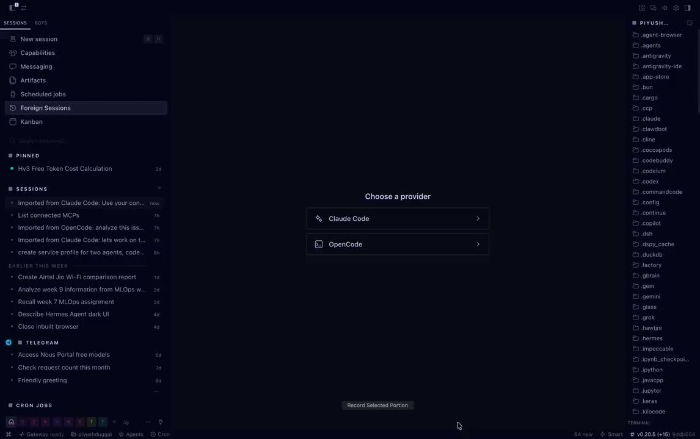

# session-importer

[](docs/demo.mp4)
*Click to watch the demo (with sound).*

A Hermes desktop plugin that surfaces your **Claude Code** and **OpenCode**
session history inside Hermes. Browse them, read them properly formatted, and
import any of them as a live, resumable Hermes session.

## What it does

- **Sidebar → Foreign Sessions page**: pick a provider (Claude Code / OpenCode),
  see every session grouped by day (Today / Yesterday / This week / by month).
- **View** — read-only transcript with real markdown rendering (the same
  pipeline Hermes chat uses) and a per-message tool-call footer
  (`⚙ 5× read · 3× grep · 1× sentry_get_sentry_resource`).
- **Import** — turns a foreign session into a resumable plain-text Hermes
  session (strict user/assistant alternation, tool activity kept as inline
  `[ran tool: name]` markers) and opens it as a tab.
- **Import all new** — bulk action with a confirm dialog and a toast summary.
- **Search + project filter chips**, persisted across restarts per provider.
- **Statusbar chip** — live count of not-yet-imported sessions.
- **⌘K commands** — "Open Foreign Sessions", refresh.

## Install

Copy the folder into your Hermes plugins root:

```
git clone https://github.com/PiyushDuggal-source/hermes-session-importer \
  ~/.hermes/plugins/session-importer
```

Enable the Python backend (it is a security boundary, so it is opt-in):

```
hermes config set plugins.enabled '["session-importer"]'
```

Then **fully quit and relaunch the desktop app** — plugin API routes mount
only at server startup. (Later `plugin.js` edits hot-reload; any
`plugin_api.py` edit needs another restart.)

## How it works

| Provider | Source | Parser |
|---|---|---|
| Claude Code | `~/.claude/projects/**/*.jsonl` (Anthropic content-block JSONL) | stock `hermes_cli.foreign_sessions` importer |
| OpenCode | `~/.local/share/opencode/opencode.db` (SQLite: `session` / `message` / `part`) | native converter in `dashboard/plugin_api.py` |

Both normalize to the same turn contract: plain `user` / `assistant` text,
consecutive same-role turns merged, synthetic payloads (diff summaries,
wrapper tags) dropped, tool activity flattened to `[ran tool: name]`. The
`/view` route reuses the exact same parsers and additionally returns
per-turn `tools: {name: count}` maps for the viewer's footer — one parsing
contract, two consumers.

**Dedup:** every import records `origin_json.imported_from
{tool, foreign_session_id, path}`; `/list` indexes those keys at list-time
(TTL-cached) so already-imported sessions show a badge and clicking one
opens the existing Hermes session instead of minting a duplicate.

## Layout

```
session-importer/
├── desktop/plugin.js        # sidebar nav, page UI (stepper, search, groups)
├── dashboard/
│   ├── manifest.json        # {"name": "session-importer", "api": "plugin_api.py"}
│   └── plugin_api.py        # /list /counts /view /import routes + OpenCode parser
└── docs/v2-research.md      # feature research notes
```

## Branches

- `v1` — minimal list + import
- `v1.1` — review-hardened (dedup alias fix, error surfacing, cache invalidation)
- `v2` — current: stepper UI, search/date-groups/filters, bulk import,
  statusbar chip, formatted transcript viewer with tool footers

## Notes

- Imports are **resumable-as-text**: the conversation continues on whatever
  Hermes model is active. Tool-call/result replay fidelity is out of scope.
- Foreign stores are opened read-only; nothing is ever written back to
  Claude Code or OpenCode.
